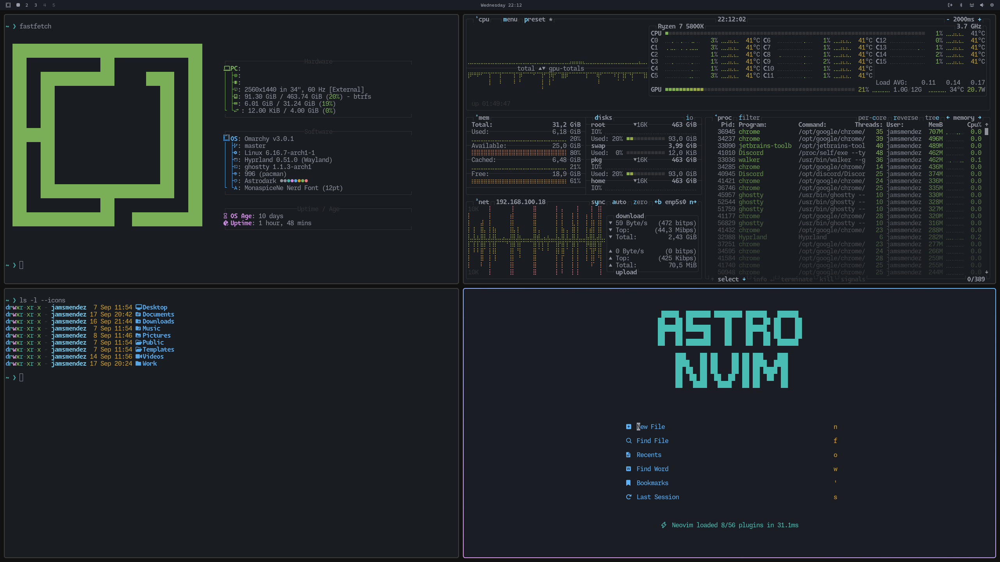

# Astrodark Theme

Astrodark theme for Omarchy based on [Astronvim](https://astronvim.com) themes



## Requirements

Omarchy 4 or later. For Omarchy 3.x, use the `v3.8.5-legacy` tag:

```bash
git checkout v3.8.5-legacy
```

## Install

```bash
omarchy theme install https://github.com/JamsMendez/omarchy-astrodark-theme
```

## Notes

Omarchy generates every app theme from `colors.toml` using the templates in `/usr/share/omarchy/default/themed/`: terminals, Hyprland, btop, Chromium, GTK, Neovim, VS Code, Helix, the keyboard backlight, the shell, and agent apps. Only the source colors, the backgrounds, the icon theme, and the previews live here.

The cursor color always follows `bright_foreground`; Omarchy has no separate cursor key.

## Neovim

A theme installed with `omarchy theme install` is a git clone, and Omarchy drops every `*.lua` file from it because Neovim and Hyprland would execute it. Omarchy then generates Neovim colors from `colors.toml` through `aether.nvim`.

To use the original AstroNvim `astrodark` colorscheme instead, add it to your own Neovim config, for example `~/.config/nvim/lua/plugins/astrotheme.lua`:

```lua
return {
  { "AstroNvim/astrotheme", name = "astrotheme", priority = 1000 },
  { "LazyVim/LazyVim", opts = { colorscheme = "astrodark" } },
}
```

## Herdr

Omarchy themes the Herdr desktop app on its own, but the terminal [herdr](https://herdr.dev) client still runs on a static config that rides on the terminal's ANSI palette, so its sidebar, panels and agent status colors never follow the active theme.

The `omarchy/` directory adds that integration for the terminal client:

| File | Role |
| --- | --- |
| `omarchy/themed/herdr.toml.tpl` | Maps `colors.toml` onto herdr's color tokens |
| `omarchy/hooks/theme-set.d/sync-herdr` | Merges the rendered colors into the live herdr config |

Install once:

```bash
mkdir -p ~/.config/omarchy/themed ~/.config/omarchy/hooks/theme-set.d
cp omarchy/themed/herdr.toml.tpl ~/.config/omarchy/themed/
cp omarchy/hooks/theme-set.d/sync-herdr ~/.config/omarchy/hooks/theme-set.d/
chmod +x ~/.config/omarchy/hooks/theme-set.d/sync-herdr
```

Then switch themes (`omarchy-theme-set astrodark`) to apply. It works for every
Omarchy theme with a `colors.toml`, not just this one.

The hook rewrites only the block between its `# >>> omarchy theme colors`
markers, so keybindings and other herdr settings are preserved. It also comments
out the seeded `[ui] accent = "blue"`, which would otherwise override the themed
accent. A running herdr server is retinted via `herdr server reload-config`; no
restart is needed.

With Glassy windows enabled (Appearance > Window Transparency), the hook keeps `panel_bg = "reset"` so the tab bar stays see-through like Omarchy's stock config. The hook runs on theme switches, so after toggling Glassy run `omarchy-theme-set astrodark` again.
